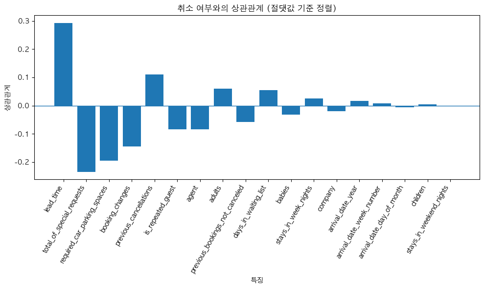
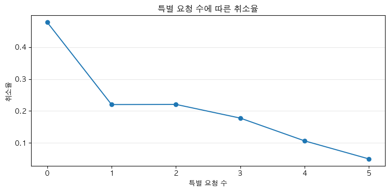
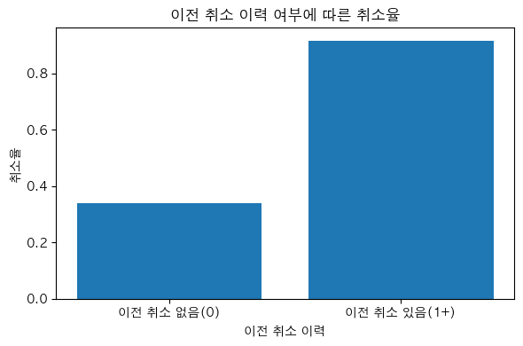

# 호텔 예약 취소 요인 분석

> **Bootcamp Mission 02** | 데이터 분석 · EDA

## 한눈에 보기

- **문제**: 호텔 예약 데이터에서 어떤 조건의 예약이 취소로 이어지는지 찾는다.
- **수행**: 결측값을 채우고 성인 0명 예약을 뺀 데이터로, 취소 여부와 예약 조건(리드타임, 특별 요청 수, 주차 요청, 예약 변경, 이전 취소 이력)을 교차해 취소율을 비교했다. 모델 없이 전처리와 시각화로 진행했다.
- **관찰**: 취소된 예약은 리드타임이 더 길었고, 이전 취소 이력이 있는 예약의 취소율이 크게 높았다. 특별 요청이나 예약 변경이 있는 예약은 취소율이 낮았다. 상관 관찰이며 인과는 확인하지 않았다.

## 데이터와 전처리

원본은 `(119390, 29)` 규모입니다. 노트북에는 서로 이어지지 않는 두 갈래의 처리가 있습니다.

| 데이터 | 처리 | 행 수 | 쓰인 곳 |
|---|---|---|---|
| `df` | 결측 채움 · 성인 0명 제외 | 118,987 | 취소율 비교 |
| `hotel_df_unique` | 완전 중복 행 제거 | 86,287 | 행 수 확인만 |
| `hotel_df` | 원본 그대로 | 119,390 | 상관계수 |

> **2026-11 검토에서 발견한 한계**: 중복 제거 결과는 이후 분석에 연결되지 않았습니다. 취소율 비교는 중복이 남아 있는 `df`로 했습니다. 다만 값이 완전히 같은 행이 실제로 같은 예약인지는 이 데이터로 확인되지 않아, 중복을 지워야 더 정확해진다고도 말할 수 없습니다.

## 그래프

아래 그림은 모두 **당시 노트북에 저장된 출력**을 그대로 꺼낸 것이며, 다시 실행해 만든 것이 아닙니다.



취소 여부(`is_canceled`)와 숫자형 컬럼의 상관계수, 절댓값 순. 전처리 전 원본(`hotel_df`)으로 계산됐습니다.



특별 요청 수별 취소율(분석용 `df` 기준). 요청이 없는 예약의 취소율이 가장 높았지만 1개와 2개는 거의 같고, 요청 수가 많은 집단은 예약 건수가 매우 적어 차이를 일반화하기 어렵습니다.



이전 취소 이력 유무별 취소율(분석용 `df` 기준). 이력이 있는 예약의 취소율이 크게 높았습니다.

## 한계

- 상관 관찰까지입니다. 예약 조건과 취소율의 관계를 본 것이고, 어떤 조건이 취소를 일으킨다는 인과는 확인되지 않습니다.
- 상관계수 그래프와 취소율 비교가 서로 다른 데이터(원본, 분석용 `df`)로 계산됐습니다.
- 예측 모델을 만들지 않아 성능 지표가 없습니다.

## 지금 다시 한다면

- 전처리한 데이터가 이후 분석에 실제로 쓰였는지 셀마다 확인하고, 상관계수도 분석용 데이터로 계산한다.
- 완전 중복 행이 같은 예약인지 가릴 식별자가 있는지 먼저 확인하고, 중복 제거 전후로 결론이 바뀌는지 비교한다.
- 집단별 취소율 옆에 예약 건수를 함께 표시해 표본이 작은 집단을 구분한다.

## 사용 기술

Python, pandas, NumPy, matplotlib, seaborn, Jupyter Notebook

## 실행 방법

```bash
pip install -r requirements.txt
jupyter notebook notebooks/mission02.ipynb
```

노트북은 같은 폴더의 `hotel_data_modified.csv`를 읽습니다. 데이터 파일은 이 저장소에 포함하지 않았습니다.

## 폴더 구조

```text
notebooks/
  mission02.ipynb      # 당시 제출 노트북 (출력 포함, 수정하지 않음)
docs/figures/          # 노트북 저장 출력에서 꺼낸 그래프
README.md
requirements.txt
```
